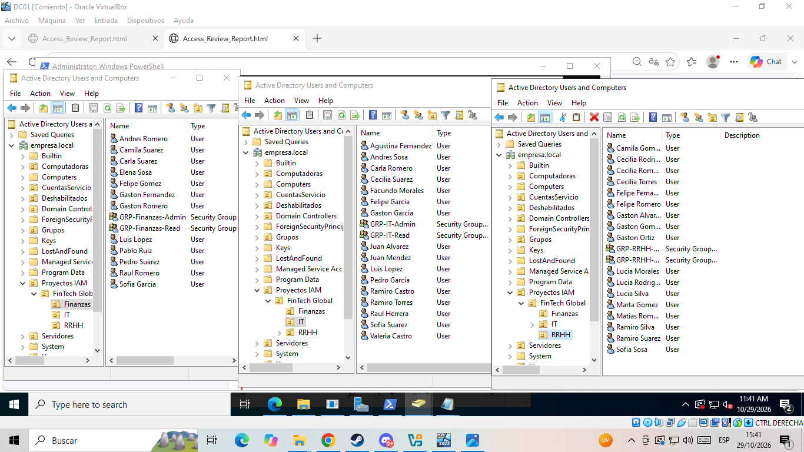
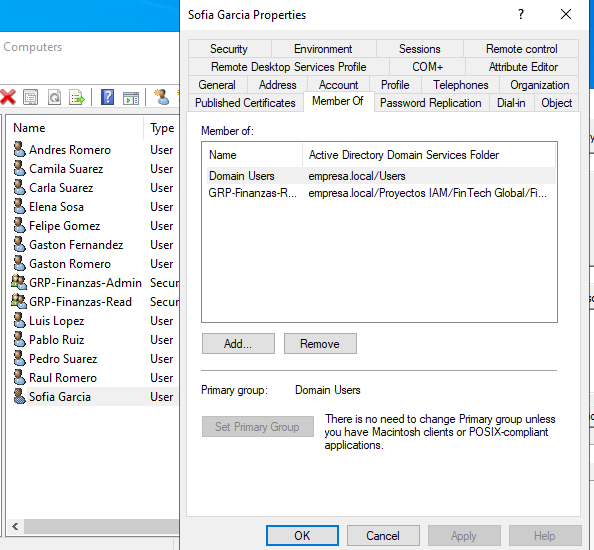
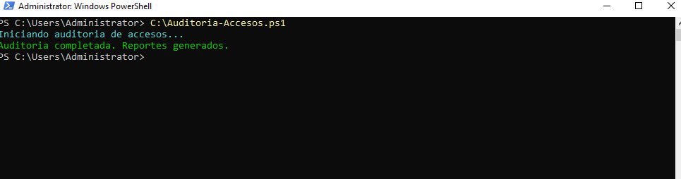
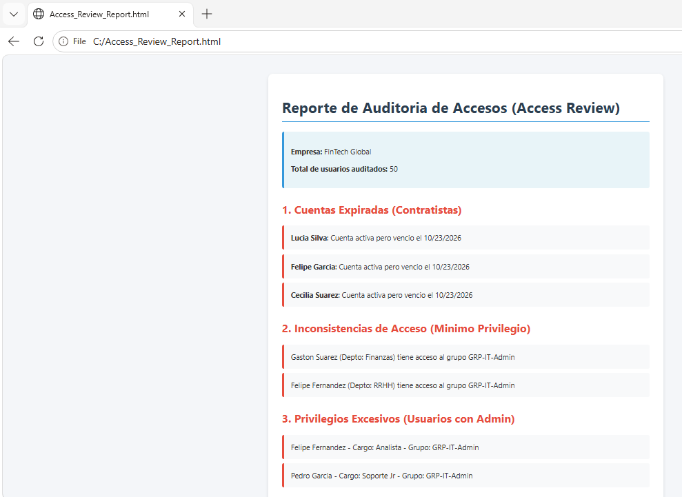
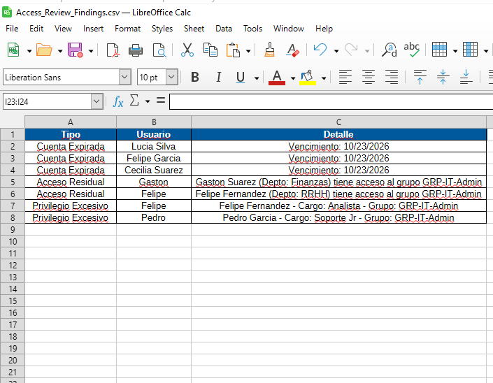
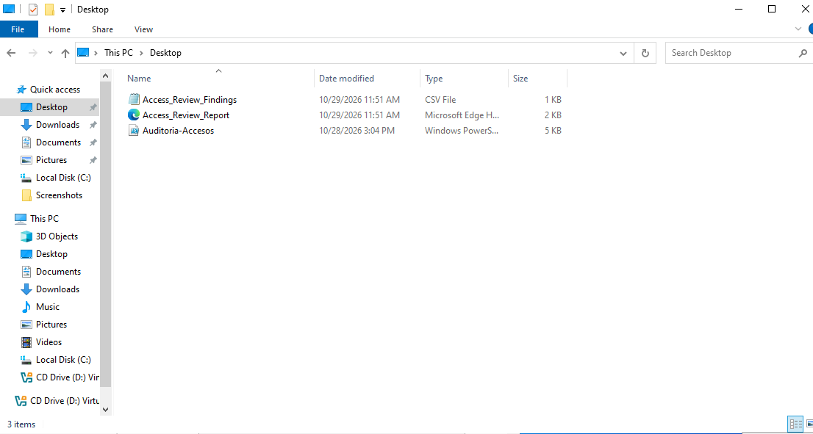

# 🔐 Proyecto: Auditoría de Accesos (Access Review) - IAM

---

## 📌 Descripción del Proyecto

Este proyecto simula una **Auditoría de Accesos (Access Review)** en un entorno corporativo ficticio llamado **FinTech Global**. El objetivo principal es aplicar el **Principio de Mínimo Privilegio** y detectar fallas comunes de seguridad en la gestión de identidades, como cuentas de contratistas vencidas, accesos residuales por cambios de área y privilegios excesivos.

El entorno fue construido en **Active Directory** y auditado mediante scripts de **PowerShell**, generando reportes automáticos en formatos visuales (HTML) y de datos (CSV).

---

## 🛠️ Tecnologías Utilizadas

- **Windows Server 2022** (Active Directory)
- **PowerShell** (Automatización y auditoría)
- **LibreOffice Calc** (Visualización de datos CSV)
- **VirtualBox** (Virtualización)

---

## 🚀 ¿Qué hace el script de auditoría?

El script `Auditoria-Accesos.ps1` analiza los 50 usuarios del entorno y detecta automáticamente:

1. **Cuentas Expiradas:** Contratistas cuya fecha de finalización ya pasó pero siguen activos.
2. **Accesos Residuales:** Usuarios que cambiaron de departamento pero conservan grupos de seguridad de su área anterior.
3. **Privilegios Excesivos:** Usuarios con cargos junior que cuentan con permisos de Administrador.

---

## 📸 Galería de Capturas

### 1. Estructura del Directorio (Active Directory)
Aquí se observa el entorno simulado con los 50 usuarios distribuidos en los departamentos de Finanzas, RRHH e IT.

### 2. Asignación de Permisos (Member Of)
Detalle de un usuario y los grupos de seguridad a los que está vinculado.

### 3. Ejecución del Script de Auditoría
Consola de PowerShell ejecutando el script que detecta las fallas automáticamente.

### 4. Reporte Visual Generado (HTML)
Interfaz web con el resumen de la auditoría, mostrando el total de 50 usuarios y los 3 tipos de hallazgos detectados.

### 5. Exportación de Hallazgos (CSV)
Archivo de datos abierto en LibreOffice Calc, listo para ser trabajado por un analista.

### 6. Archivos Generados en el Sistema
Prueba de la generación exitosa de los archivos (Script, HTML y CSV) en el disco local.

---

## 📈 Resultados Obtenidos

- **50 usuarios** auditados en el entorno simulado.
- **Múltiples hallazgos** detectados automáticamente (contratistas, accesos residuales y admins).
- Generación exitosa de reportes en **HTML y CSV** para diferentes audiencias (visual y analítica).

---

## 👨‍💻 Autor

**Ignacio Cornejo**  
[LinkedIn](https://www.linkedin.com/in/ignacio-cornejo/) | [GitHub](https://github.com/IgnacioCornejo)
